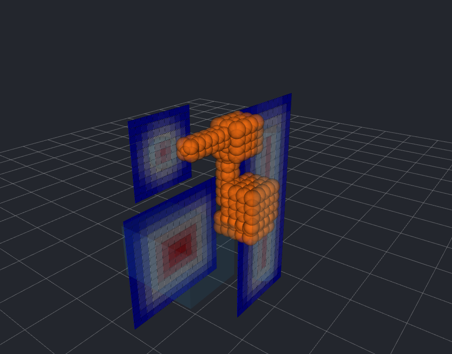

# ROSCon collision demo

Visualize an ABB IRB 2600 in RViz, move its joints, and check collisions with itself
and the environment. Built for ROS 2 Jazzy.

## Build

Install ROS 2 Jazzy first. GPU modes also need an NVIDIA GPU, a working driver,
and the CUDA toolkit. The commands below use GCC 12 for CUDA, as tested on this machine.

```bash
cd /home/santosh/event_ws/roscon_ws
source /opt/ros/jazzy/setup.bash
rosdep install --from-paths src --ignore-src -r -y
colcon build --symlink-install --packages-up-to roscon_collision \
  --cmake-args -DROSCON_ENABLE_CUDA=ON \
  -DCMAKE_CUDA_HOST_COMPILER=/usr/bin/g++-12
source install/setup.bash
```

For an FCL-only build, replace the two CMake options with `-DROSCON_ENABLE_CUDA=OFF`.

## Launch

```bash
source /opt/ros/jazzy/setup.bash
source /home/santosh/event_ws/roscon_ws/install/setup.bash
ros2 launch roscon_collision demo.launch.py
```

Choose a mode in the RViz panel:

| Mode | Robot | Environment |
| --- | --- | --- |
| FCL geometry (CPU) | Meshes | Original geometry |
| Sphere pairs (CUDA GPU) | Spheres | Spheres |
| Sphere / SDF (CUDA GPU) | Spheres | Signed distance fields |

To start directly in SDF mode:

```bash
ros2 launch roscon_collision demo.launch.py collision_backend:=gpu_sdf
```

Use `collision_backend:=gpu_spheres` for sphere-to-sphere mode.

In SDF mode, each object has a colored distance-field slice: **red inside, white
near the surface, blue outside**. The environment surfaces are transparent so the
slices remain visible. These field colors are separate from collision highlights.

## RViz output

SDF mode in RViz:



- **Joints:** move sliders or enter joint positions.
- **Collisions:** inspect colliding link/link and link/object pairs.
- **Colors:** magenta = self-collision, red = environment collision, yellow = both.
- **Camera:** left-drag to orbit, middle-drag to pan, scroll to zoom.

Try setting `joint_2` to `1.2` radians to move the arm into the workbench.
Use **Reset joints** to return to the starting pose.

Edit [environment.yaml](roscon_collision/config/environment.yaml) to change the scene,
then restart the launch. Sphere models are approximate; mesh SDFs require closed,
consistently oriented, non-self-intersecting meshes.

Robot model: [ROS-Industrial ABB](https://github.com/ros-industrial/abb).
See [model attribution](roscon_description/NOTICE.md) for license details.
