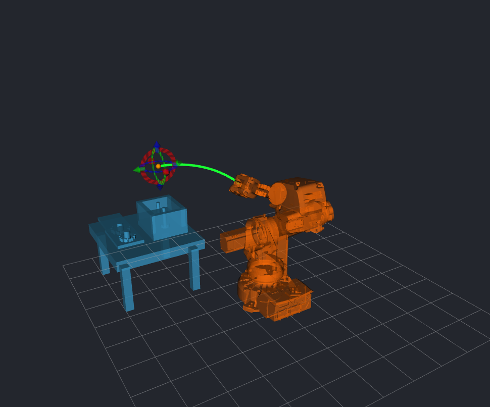

# Gearbox assembly planning environment

A separate, static ABB IRB2600 assembly cell for the existing IK, OMPL,
STOMP/CHOMP-style optimization, collision checking and RViz preview pipeline.
The planner panel lives in `roscon_rviz_plugins`.

The cell contains a workbench, an open gearbox housing, two bearing seats and
shafts, a parts tray with two simplified toothed gears, and a cover on its rack.
All visible cell parts are collision objects. Separate boxes form the housing
walls; no bounding box fills its opening. Dimensions are in metres in `base_link`.
The geometry is illustrative, not a manufacturing CAD model.



## Build and launch

From the ROS workspace root:

```bash
source /opt/ros/jazzy/setup.bash
source install/setup.bash
colcon build --packages-up-to roscon_gearbox_demo --cmake-args -DCMAKE_BUILD_TYPE=Release
source install/setup.bash
ros2 launch roscon_gearbox_demo demo.launch.py
```

Run this launch alone; do not run the standalone IK, collision or planner demo
simultaneously, because they would publish competing robot states.

In the RViz Planner panel:

1. Click **Load demo target** to load the housing inspection pose.
2. Choose the OMPL planner, optimizer and collision backend.
3. Click **Plan**, then **Validate** and **Play** to preview the accepted path.
4. Drag/rotate the interactive target or edit the Cartesian fields to test other
   poses. A target inside the bench or housing wall should be rejected.
5. After switching backend, validate again before playback, or create a new plan.
   Conservative sphere checks can reject a path that FCL accepts.

Other presets are selectable at launch:

```bash
ros2 launch roscon_gearbox_demo demo.launch.py target:=transfer backend:=sdf
ros2 launch roscon_gearbox_demo demo.launch.py target:=housing_approach
```

`config/targets.yaml` defines repeatable target configurations. Only their FK
poses become requests: the planner still runs multi-seed IK and collision checks.
The launch sets the generic planner `demo_joints` parameter; users do not enter IK
seeds. All text stays in the panel, with no floating labels in the scene.

## Repeatable validation

```bash
ros2 run roscon_gearbox_demo validate_cell
colcon test --packages-select roscon_gearbox_demo --event-handlers console_direct+
colcon test-result --verbose
```

The validator runs without RViz or another node. For each FCL, spheres and SDF
backend it plans the ordered transfer/approach/inspection sequence using
RRTConnect + STOMP, validates every path edge and the Cartesian endpoint, then
checks that a known arm configuration collides with the fixture and that a path
into it is rejected. It exits nonzero on failure. Other algorithm combinations
remain available through the existing panel and planner package tests.

## Scope

This is an assembly **motion-planning** test cell. Targets are the bare robot
flange above the fixture, not insertion poses for a mounted tool. Parts stay
static: no grasping, attached payload, gear meshing, contact simulation or
hardware execution is implemented. Add gripper/payload collision geometry and
contact-aware control before attempting physical insertion. Collision validation
samples joint-space edges; it is not a continuous swept-volume guarantee.

Edit `config/environment.yaml` to change the collision geometry and matching
RViz visuals. Restart the launch after editing and rebuilding. The usual ABB
wrist mesh exclusion (`link_4`, `link_6`) is retained from the existing demo.
