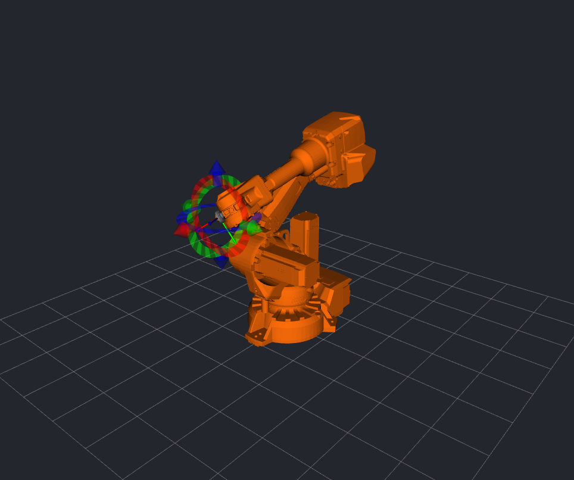

# IPOPT inverse kinematics

A small ROS 2 Jazzy C++ package for full-pose inverse kinematics. The demo uses
this workspace's `roscon_description` ABB IRB 2600-12/1.65 arm. No neural network or checkpoint is
needed. This is a configuration solver and visualization, not a motion controller.

## Build and run

Install system dependencies once:

```bash
sudo apt-get update
sudo apt-get install coinor-libipopt-dev libeigen3-dev ros-jazzy-kdl-parser \
  ros-jazzy-urdf ros-jazzy-interactive-markers ros-jazzy-robot-state-publisher ros-jazzy-rviz2 \
  libfcl-dev libassimp-dev libyaml-cpp-dev
```

From the workspace:

```bash
cd ~/event_ws/roscon_ws
source /opt/ros/jazzy/setup.bash
colcon build --packages-up-to roscon_kinematics --cmake-args -DCMAKE_BUILD_TYPE=Release
source install/setup.bash
ros2 launch roscon_kinematics demo.launch.py
```

The **Kinematics** panel opens automatically. All status text is in this panel;
the 3D scene contains the robot, target, achieved axes, and position-error line.

- **Joints:** read current positions in radians, edit target positions, then press
  **Apply joints**. **Copy current joints** fills the target fields. Direct joint
  commands still pass the backend's hard joint-limit and singularity checks.
- **Cartesian:** read XYZ in metres and roll/pitch/yaw in degrees. Edit targets,
  then press **Solve pose**. **Copy current pose** fills the fields. Orientation
  uses `Rz(yaw) Ry(pitch) Rx(roll)`; RPY is ambiguous at pitch +/-90 degrees.
- **Interactive target:** the XYZ arrows and rotation rings are always active.
  Select RViz's **Interact** tool and drag a handle. Releasing the mouse runs IK.
  The target has no text label and there is no enable/disable checkbox.
- **Multiple IK solutions:** in the Cartesian tab, apply the desired pose or drag
  the target, then press **Find alternatives for current target**. Choose an entry
  and press **Preview selected solution** to display its joints in RViz while
  keeping the requested pose and orientation unchanged. No seed input is needed.
- **Reset to initial configuration:** restore the validated startup joints and
  set the target to their achieved pose. Use Copy current to refresh edited fields.

Live readouts do not overwrite target drafts. Commands are sent only by Apply,
Solve, Find alternatives, Preview, Reset, or an interactive target release. The panel never publishes
`/joint_states`; the backend remains the single source of displayed joint states.
Controls disable if status, joints, or current pose are stale for two seconds.
Joint editors show URDF bounds; the backend may reject values near those bounds
because it also enforces the configured joint-limit margin.

The status distinguishes target reached, feasible approximation, and rejected
commands. A rejected command leaves the displayed robot unchanged. All error
metrics refer to the displayed robot. No text markers or interactive descriptions
are drawn in the 3D scene.

If using your own RViz configuration, choose **Panels > Add New >
roscon_rviz_plugins/KinematicsPanel** and add the interactive marker display on
the **Interactive Markers Namespace** set to `/ik_target`. The supplied
configuration already includes both. Jazzy uses a server namespace, not an
`Update Topic` configuration key.

The alternative search tries the current configuration plus 16 predefined seeds
spread across the allowed joint ranges. Only solutions that reach the target and
pass both hard constraints and the collision post-check are listed. Configurations within 0.05 radians per
joint are deduplicated, accounting for equivalent full turns. The panel shows
progress, seed number, and pose errors. A new target, joint command, or reset
clears the list; reset also cancels an ongoing search between seed solves. This
is a local search and does not guarantee every possible solution.

Shared custom interfaces live in the generic `roscon_msgs` package.

ROS interfaces (also available for scripts):

| Interface | Type | Meaning |
| --- | --- | --- |
| `/target_pose` | `geometry_msgs/msg/PoseStamped` | Full-pose target in configured base frame |
| `/ik_joint_command` | `sensor_msgs/msg/JointState` | All joint names and requested positions, exactly once |
| `/ik_find_solutions` | `geometry_msgs/msg/PoseStamped` | Search predefined seeds for this target |
| `/ik_solutions` | `roscon_msgs/msg/IKSolutions` | Latched search progress and distinct valid candidates |
| `/ik_select_solution` | `roscon_msgs/msg/IKSelection` | Preview an index from a specific search generation |
| `/ik_target_pose` | `geometry_msgs/msg/PoseStamped` | Currently requested target |
| `/ik_environment` | `visualization_msgs/msg/MarkerArray` | Latched static obstacle surfaces |
| `/ik_current_pose` | `geometry_msgs/msg/PoseStamped` | Achieved end-effector pose |
| `/joint_states` | `sensor_msgs/msg/JointState` | Validated displayed configuration |
| `/ik_status` | `std_msgs/msg/String` | Solver outcome and error metrics |
| `/reset_ik` | `std_srvs/srv/Trigger` | Restore startup configuration |

Target frames are checked; no implicit coordinate conversion is performed.
Quaternion inputs are normalized after checking they are finite and nonzero.

Run without RViz: `ros2 launch roscon_kinematics demo.launch.py rviz:=false`.
Do not run another joint state publisher for the same joints during this demo.
Run this launch separately from `roscon_collision demo.launch.py`, which also
starts a robot state publisher and joint controls. The IK node uses the shared
collision library directly; it does not need the collision demo node.

## Collision post-check and test environment

Every valid, nonduplicate IK candidate is checked before it enters the GUI list.
The synchronous `roscon_collision::SceneChecker` uses the existing conservative
robot-sphere cover, sphere-pair self checks, and signed-distance environment
checks. It evaluates the shared SDF formulas explicitly on the CPU, with no CUDA
requirement and no dependency on the displayed `/joint_states`. The CUDA collision
demo still uses the same formulas; it never silently falls back to CPU.

Adjacent links and the explicit `[link_4, link_6]` demo exclusion follow
`roscon_collision`'s existing policy. The latter accounts for overlapping supplied
wrist meshes. Other self pairs and every robot/environment pair are checked.
The sphere cover fills each collision shape's bounding box, so it can reject
configurations whose actual meshes do not collide. `collision_sphere_radius`
controls the cover resolution, not a guaranteed clearance margin.

The panel reports self/environment rejection counts, failed checks, and the last
rejected link/object pairs. Counts are per checked candidate, not unique rejected
branches; one candidate can count in both categories. A failed check never adds
a solution. Preview rechecks the selected configuration. An empty list leaves
the displayed joints unchanged and does not prove that no valid solution exists.

The blue workbench, pillar, and ball are loaded from `config/environment.yaml` and
published on `/ik_environment`. Their displayed geometry and collision geometry
come from the same definitions. All positions use the URDF root frame, which must
match the configured IK base. The scene is static: edit the file and relaunch, or
pass `environment_file:=/absolute/path/environment.yaml`. Use `objects: []` for an
empty environment; self-collision checks still run. Mesh obstacles must be closed
and consistently oriented, as in the original SDF checker.

For a GUI test, keep the startup roll/pitch/yaw and set XYZ to `(0.65, -0.65, 1.0)`
(the ball centre), press **Solve pose**, then **Find alternatives for current
target**. The search should show environment rejections and an empty list.
The single solve can display a colliding pose because it is outside this
post-filter's scope; reset restores the startup pose. The automated ROS test
submits search targets directly and verifies that searches leave the robot
unchanged, including targets inside the workbench and pillar.

A collision-free endpoint does not validate motion to it; no trajectory collision
checking is performed.

## Optimization, step by step

1. KDL obtains position `p(q)`, rotation `R(q)`, and geometric Jacobian `J(q)`
   from the URDF. Only independent, bounded revolute joints are supported.
2. IPOPT minimizes:

   `position_weight * ||(p(q) - target_position) / position_scale||²`

   `+ orientation_weight / 2 * ||target_rotationᵀ R(q) - I||²_F`

   `+ posture_weight * ||q - previous_q||²`.

   The orientation term is smooth and avoids Euler angles. Its value is
   `2*(1-cos(angle_error))`; it is not an angle squared globally. Exactly 180-degree
   orientation errors can be stationary, so use intermediate targets if necessary.
3. URDF joint limits, reduced by `joint_margin`, are hard variable bounds.
   No clipping of a solved configuration is used to hide constraint violations.
4. Translational Jacobian rows are divided by `characteristic_length` (metres).
   Angular rows are unchanged. The singularity threshold applies to this scaled,
   full six-dimensional task Jacobian, in the configured base frame.
5. To enforce `minimum singular value >= s`, use the equivalent condition
   `J_scaled J_scaledᵀ - s² I = L Lᵀ`. The lower triangular matrix `L` has 21
   independent entries. Matching the 21 lower-triangle entries creates smooth
   equality constraints. Because `L Lᵀ` is positive semidefinite, every eigenvalue
   of `J_scaled J_scaledᵀ` is at least `s²`. This is a true spectral margin, not
   a determinant proxy. `L` entries do not need nonnegative diagonal bounds.
6. Derivatives are explicit central differences with configurable step size.
   IPOPT uses its standard limited-memory Hessian approximation. These numerical
   choices are visible in `solver.cpp`; this educational version prioritizes
   readability over real-time performance. For a six-joint robot the problem has
   27 variables and 21 equalities. The factorization can be poorly conditioned
   exactly at the singularity boundary.
7. Before publishing a solution, independently recompute joint bounds and the
   minimum singular value using SVD. Only successful/acceptable IPOPT termination
   with valid constraints is accepted. Target success additionally requires the
   configured position and orientation tolerances. IPOPT success alone does not
   imply that the target was reached.

Defaults: 5 mm position tolerance, 0.02 rad orientation tolerance, 0.05 scaled
singular-value margin, 0.01 rad joint-limit margin, and 250 iterations. These are
demo settings, not certified robot limits. IPOPT is a local optimizer, so the seed
matters. It can fail to find a feasible configuration even when one exists.
An unreachable target can produce a valid approximate pose or a rejected solve.
Hard constraints are satisfied numerically; the independent output check does not
relax the requested singular-value threshold.

## Configuration and scope

Edit a copy of `config/solver.yaml`, then pass `parameters:=/absolute/path/solver.yaml`.
The YAML documents all runtime options. The initial pose must pass the same checks
as later poses. Adjust `initial_joints` if the solver cannot initialize.

For another robot, pass `urdf_file:=/absolute/path/robot.urdf`, configure the chain
and initial joints, and change RViz's fixed frame if needed. Supply expanded URDF,
not unexpanded xacro. At least six independent bounded revolute joints are required.
Meshes must resolve through installed ROS packages or valid file paths. The default ABB model already uses portable `package://roscon_description/` mesh URLs.
The default chain is `base_link` to `flange`, with joints `joint_1` through `joint_6`.

Collision post-checks apply to multiple-solution generation and selection only;
the existing single Solve pose, interactive release, and Apply joints controls
still check kinematics constraints only. There is no velocity/acceleration constraint, trajectory
planning, hardware command output, or guarantee of nonsingularity between displayed
configurations. The single-threaded backend solves on a Cartesian command or mouse release,
so backend updates pause during a solve; the panel remains responsive. Joint bounds, seed distance, and singularity margin
apply to configurations only. Avoid interpreting a jump in RViz as a safe motion.

## Code map and tests

- `include/roscon_kinematics/solver.hpp`: settings, robot interface, and result contract.
- `src/solver.cpp`: URDF kinematics, IPOPT callbacks, and independent acceptance.
- `../roscon_collision/src/scene_checker.cpp`: candidate FK, shared SDF/self checks, environment markers.
- `src/multi_seed.cpp`: predefined seeds and geometric duplicate filtering.
- `../roscon_msgs/msg/`: solution list and generation-checked preview interfaces.
- `src/node.cpp`: validated commands, interactive target, pose readouts, and scene geometry.
- `../roscon_rviz_plugins/src/kinematics_panel.cpp`: Qt controls and ROS subscriptions.
  Callbacks run on the Qt thread through a timer; there are no widget worker threads.
- `launch/demo.launch.py`: the existing ABB URDF for IK and robot_state_publisher.
- `test/test_solver.cpp`: reachable/unreachable targets, infeasible margin,
  invalid inputs, and the spectral constraint identity.
- ABB integration tests also exercise predefined seeds, hard bounds, pose
  tolerances, and duplicate filtering; the panel test covers search and preview.

```bash
cd ~/event_ws/roscon_ws
source /opt/ros/jazzy/setup.bash
source install/setup.bash
colcon test --packages-select roscon_rviz_plugins roscon_kinematics --event-handlers console_direct+
colcon test-result --verbose
```

IPOPT interface reference: https://coin-or.github.io/Ipopt/INTERFACES.html

## Local IPOPT installation on this machine

IPOPT and its MUMPS/Scotch dependencies are installed without sudo under
`~/event_ws/roscon_ws/.deps/ipopt`. This prefix contains extracted Ubuntu packages
and is outside the source repository. It is persistent, unlike the original
validation copy in `/tmp`. The package installs environment hooks so sourcing
`install/setup.bash` supplies both runtime library paths and `PKG_CONFIG_PATH`.

To rebuild with this local installation:

```bash
cd ~/event_ws/roscon_ws
source /opt/ros/jazzy/setup.bash
colcon build --packages-select roscon_kinematics --cmake-clean-cache \
  --cmake-args -DCMAKE_BUILD_TYPE=Release -DIPOPT_PREFIX="$PWD/.deps/ipopt"
source install/setup.bash
ros2 launch roscon_kinematics demo.launch.py
```

For a fresh machine, use the system dependency installation above. To switch
this existing build to system IPOPT, use a fresh shell, unset `PKG_CONFIG_PATH`,
and rebuild with `--cmake-clean-cache --cmake-args -DIPOPT_PREFIX=`.
The local prefix option currently targets Ubuntu x86-64 library layouts.

Interactive target rendering after the namespace fix:



RViz Jazzy's namespace property is defined in the
[InteractiveMarkerDisplay implementation](https://github.com/ros2/rviz/blob/jazzy/rviz_default_plugins/src/rviz_default_plugins/displays/interactive_markers/interactive_marker_display.cpp).
