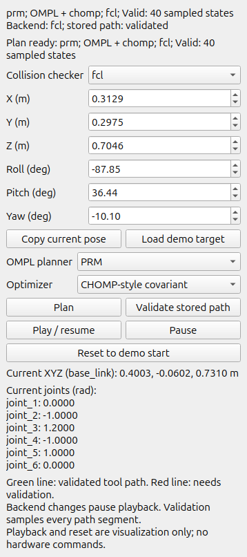
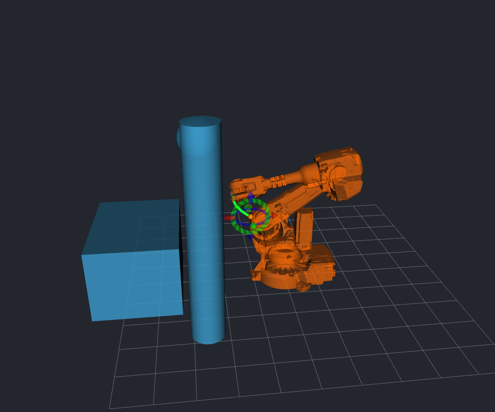

# Planner validation

Validated in the existing ROS 2 Jazzy ABB workspace.

- Release build completed with the installed OMPL and STOMP libraries.
- All nine combinations of RRTConnect/RRTstar/PRM and None/STOMP/CHOMP-style
  passed the ABB planning test with FCL. Returned paths were independently
  checked and their endpoints verified.
- ABB paths passed each selected FCL, sphere, and SDF checker. STOMP and
  covariant refinement were checked with all three collision representations.
- A synthetic obstacle between collision-free endpoints was detected during
  edge validation by all three backends. Positive/negative clearance cases,
  malformed paths, joint-limit violations, and blocked goals were also tested.
- Covariant refinement reduced a rough path's acceleration cost without moving
  its endpoints. It uses a local educational CHOMP-style implementation; STOMP
  uses the upstream library.
- Qt tests verified both algorithm dropdowns and pose, plan, validate,
  backend-change, playback, and reset commands.
- ROS integration verified planning leaves the robot stationary, changing
  collision backends blocks playback until revalidation, rejected validation
  prevents playback, pause/resume works, and failed plans clear stale output.
  Conservative collision models can reject a path accepted by FCL; this was
  handled by replanning under the selected checker.
- The planner's full colcon test run reported zero errors or failures. The
  existing collision, IK, and RViz regression suites also passed. Ten existing
  opt-in GPU ROS integration cases were skipped; they are not used by this
  CPU planning pipeline.
- The nine-combination test was rerun successfully after adding a mutex around
  mutable collision transforms for OMPL validity callbacks.

An actual RViz rendering harness selected PRM + CHOMP-style in the panel and
planned the longer example target. It observed a validated 40-sample path,
interactive target, trajectory marker, and three obstacle scene nodes. Inspected
captures are saved below. The camera and robot transparency make the green tool
path visible. Playback animates the full robot using the joint trajectory.

Path acceptance uses discrete samples at at most 0.03 rad per joint by default;
it is not continuous collision certification. Display timestamps are not
hardware-ready trajectory timing. The scene is static and no hardware commands
are issued.

## RViz plugin package ownership

The planner panel source, header, test, and plugin registration now live in
`roscon_rviz_plugins`. The exported class is
`roscon_rviz_plugins/PlannerPanel`; the planner demo configuration uses this ID.
The planner backend no longer directly depends on Qt, rviz_common, or pluginlib.
The relocated panel tests passed, and an actual RViz load from the new package
completed PRM + CHOMP-style planning and rendered the target, path, and obstacles.
